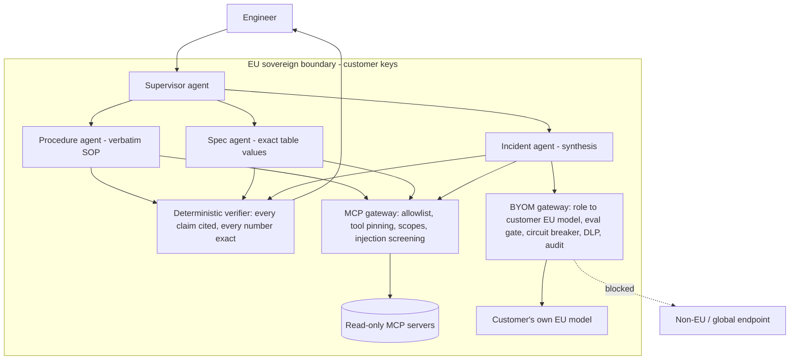

# Sovereign Agentic AI: reference build

An **EU-sovereign, multi-agent AI system** for engineering knowledge in a regulated, IP-sensitive industry (reference case: a semiconductor manufacturer answering questions over SOPs, spec tables and incident reports).

The customer **brings its own models (BYOM)** and **its own keys (BYOK / external key management)**. All inference, data, logs and backups stay in **EU member-state regions**. AWS is the primary target, with Google Cloud equivalents.

> **Status:** design and reference build, tested against mocks. 106 Python tests, 24 Rego tests and the Prometheus rule tests pass. Nothing has been run against real cloud endpoints. See [docs/DESIGN.md](docs/DESIGN.md) section 7 for exactly what was and wasn't validated.

## Architecture in one picture



**Encryption protects the vault, DLP watches the door, and classification tells both what matters.**

## What's in the repo

| Folder | What it shows | Validated |
|---|---|---|
| `agents/` | LangGraph supervisor, Procedure / Spec / Incident agents, deterministic verifier, human-in-the-loop `interrupt()` with idempotent writes, bounded loops; BYOM gateway with role resolution, capability and region checks, full-jitter retries, per-model circuit breakers, eval gate, token budget, search-only fallback, metadata-only audit | 32 tests pass (graph runs on a LangGraph-compatible stand-in if `langgraph` isn't installed) |
| `mcp/` | Secured MCP server (spec 2026-07-28, Python SDK v2 `MCPServer`): OAuth resource server, audience and per-tool scope checks, 401/403 challenges, `ToolError` vs masked crashes, read-only DB credential; MCP gateway with server/tool allowlist, SHA-256 tool-definition pinning (tool poisoning / rug pull), injection screening, rate limits; AgentCore Cedar policy sample | 40 tests pass |
| `data_protection/` | Permission- and classification-aware retrieval filter, input/output DLP with reversible redaction and document fingerprinting, permission-scoped semantic cache, key-rotation coverage and crypto-shredding simulation; Rego (Terraform residency + CMK, Kubernetes guardrails), Cedar policies, AWS SCP, GCP org policies, Bedrock Guardrails config | 25 Python + 24 Rego tests pass; Cedar not tool-validated |
| `ops/` | Evaluation harness with KPI gates (100% exact numeric match, zero out-of-region calls, model-swap regression), GitHub Actions (OIDC, scan, sign, eval gate, Helm), GitLab CI sketch, Terraform (EU region pinning, KMS CMK), Helm chart (probes, HPA, PDB, NetworkPolicy, canary), Prometheus multi-window burn-rate SLO alerts | Harness 9 tests pass; alerts promtool-tested; workflow actionlint-clean; Terraform/Helm syntax-checked only |
| `docs/` | Full design: architecture, component table, decisions and code per layer, threat model mapped to OWASP LLM Top 10 (2025) and OWASP Agentic (ASI01–ASI10), phased rollout, provider-outage runbook, open questions | n/a |

## Security checks (blocking on every push and pull request)

The code was written with help from AI coding tools, so it is treated as untrusted input and verified automatically by `.github/workflows/ci.yml`:

| Check | Tool | What it catches |
|---|---|---|
| All test suites | unittest, pytest, eval harness | Functional and quality regressions, including negative tests (wrong token audience, missing scope, injected text in tool results) |
| Static security analysis | Ruff `S` rules (Bandit's checks) | Hard-coded secrets, SQL built from strings, unsafe calls such as `eval`, `pickle`, `shell=True` |
| Dependency audit | pip-audit | Known vulnerabilities in dependencies |
| Secret scanning | gitleaks, full history | Credentials committed by mistake (fake test keys are allowlisted in `.gitleaks.toml`) |

Findings from the first scan, and how they were resolved: a demo signing secret now comes from the environment (production uses identity-provider keys); a SQL query that interpolates a table name now checks it against a fixed allowlist (user text was already parameterised); retry jitter is marked as non-cryptographic randomness.

## Run the tests

```bash
pip install -r requirements.txt
ruff check .                              # security lint (pip install ruff)          # langgraph, redis, opentelemetry are optional
cd agents && python -m unittest test_all && cd ..
cd data_protection && python -m unittest test_data_protection && cd ..
cd mcp && python -m pytest -q tests/ && cd ..
cd ops/eval && python -m unittest test_eval_harness && python eval_harness.py && cd ../..
opa test data_protection/policies/rego/   # if OPA is installed
```

## Skills demonstrated

- **Agentic AI and multi-agent orchestration:** supervisor/specialist/verifier pattern, model per role, error handling (transient vs permanent, backoff with jitter, circuit breakers, idempotency, bounded loops), human-in-the-loop.
- **MCP:** stateless streamable HTTP, OAuth 2.1 resource server, read-only at server and credential layers, gateway governance.
- **Data sovereignty and security:** EU-only routing, customer-managed keys and rotation, DLP, classification, policy as code (OPA/Rego, Cedar), guardrails.
- **DevOps / SRE:** CI/CD with OIDC and signed images, evaluation gates, Terraform, Helm, canary and rollback, SLOs and burn-rate alerting.
- **Python, testing and documentation:** unit, contract, golden-set and policy tests; design documentation.
